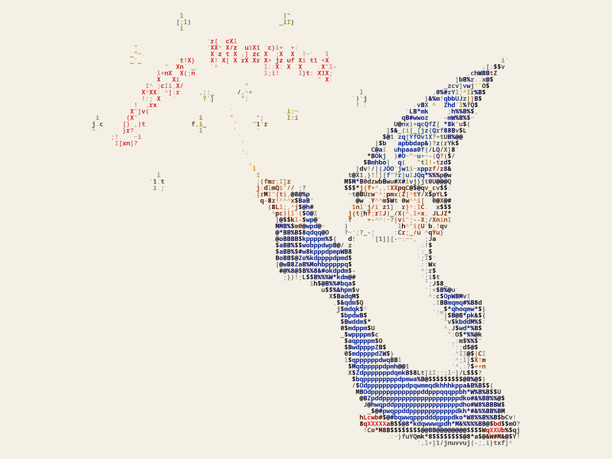

# imagen-a-ascii

Convierte cualquier imagen en **ASCII art a color**: cada letra toma el color de su parte de la imagen y el fondo queda limpio para que la figura resalte. Funciona en **Windows, Linux y macOS**, y también como página web que no necesita instalar nada.

| Original | En ASCII |
|---|---|
|  |  |

*English summary at the end.*

---

## Índice

1. [Dos formas de usarlo](#dos-formas-de-usarlo)
2. [Página web (sin instalar nada)](#1-página-web-sin-instalar-nada)
3. [Comando de terminal](#2-comando-de-terminal)
   - [Windows](#windows) · [Linux](#linux) · [macOS](#macos) · [Sin instalar](#sin-instalar-cualquier-sistema)
   - [Cómo se usa](#cómo-se-usa) · [Opciones](#opciones) · [Recetas](#recetas)
4. [Cómo funciona](#cómo-funciona)
5. [Problemas comunes](#problemas-comunes)
6. [Para desarrolladores](#para-desarrolladores)
7. [Licencias de terceros](#licencias-de-terceros)
8. [English](#english)

---

## Dos formas de usarlo

| | Página web | Comando de terminal |
|---|---|---|
| **Instalar** | Nada | Python y un comando |
| **Ideal para** | Cualquier persona | Quien use la terminal o quiera convertir muchas imágenes |
| **Formatos** | PNG, SVG, TXT y copiar el texto | PNG, JPG, WebP, SVG, TXT, HTML y vista en la terminal |
| **Sistemas** | Cualquiera con navegador, incluso el celular | Windows, Linux y macOS |

Las dos usan la misma técnica y dan el mismo resultado.

---

## 1. Página web (sin instalar nada)

1. Descarga el proyecto: arriba en esta página, botón verde **Code → Download ZIP**, y descomprímelo.
2. Entra a la carpeta `web` y abre **`index.html`** con doble clic. Se abre en tu navegador (Chrome, Edge, Firefox, Safari, Brave…).
3. Pon una imagen de cualquiera de estas formas:
   - arrástrala al recuadro,
   - haz clic en el recuadro para elegirla,
   - o cópiala y pégala con **Ctrl+V** (en Mac, **Cmd+V**).
4. Mueve los controles: el resultado cambia al momento.
5. Descarga el resultado en **PNG**, **SVG** o **TXT**, o usa **Copiar texto**.

> Funciona sin internet. Tu imagen nunca sale de tu computadora: todo se procesa en el navegador.

Si no tienes una imagen a mano, usa **Probar con una imagen de ejemplo**.

### Qué hace cada control

| Control | Para qué sirve |
|---|---|
| **Letras por fila** | Más letras, más detalle; menos letras, más estilo “retro”. |
| **Caracteres** | *Detallada* (70 caracteres, el más fino), *Simple* (10), *Bloques* (░▒▓█, estilo píxel) o los tuyos, ordenados de vacío a lleno. |
| **Limpieza del fondo** | Súbela si el fondo sale lleno de letras; bájala si se pierden partes de la figura. |
| **Negros / Blancos** | Acercarlos sube el contraste. |
| **Brillo / Saturación** | Igual que en un editor de fotos. |
| **Aclarar letras** | Hace los colores de las letras más claros para que se lean sobre fondo oscuro. |
| **Color de fondo** | El fondo del resultado. |
| **Fondo claro** | Para imágenes claras (dibujos sobre blanco, logos, capturas). **Se activa solo** cuando la imagen es clara. |
| **Un solo color** | Todas las letras del mismo color, estilo terminal antigua. |
| **Letra negrita** | Letras más gruesas; se ven mejor en tamaños chicos. |

---

## 2. Comando de terminal

El comando se llama `imagen-a-ascii`. Se instala con **pipx**, que deja el programa aislado para que no choque con nada de tu sistema.

### Windows

1. **Instala Python.** Abre **PowerShell** (tecla Windows, escribe `PowerShell` y Enter) y corre:

   ```powershell
   winget install Python.Python.3.12
   ```

   O descárgalo de [python.org](https://www.python.org/downloads/) y, en el instalador, marca **“Add python.exe to PATH”**.
   **Cierra PowerShell y ábrelo de nuevo.**

2. **Instala pipx:**

   ```powershell
   py -m pip install --user pipx
   py -m pipx ensurepath
   ```

   **Cierra PowerShell y ábrelo de nuevo** (así reconoce los comandos nuevos).

3. **Instala imagen-a-ascii:**

   ```powershell
   pipx install https://github.com/uxvcharlie/imagen-a-ascii/archive/refs/heads/main.zip
   ```

4. **Pruébalo:**

   ```powershell
   imagen-a-ascii --version
   ```

**Truco en Windows:** para no escribir la ruta de la imagen, escribe `imagen-a-ascii ` (con espacio al final) y **arrastra la imagen a la ventana de PowerShell**: se pega su ruta sola. Luego presiona Enter. El resultado queda junto a la imagen original, con `-ascii` al final del nombre.

Para la vista previa a color en la terminal (`-t`), usa **Windows Terminal**, que ya viene en Windows 11. En Windows 10 se instala desde la Microsoft Store.

### Linux

1. **Instala pipx** con el gestor de tu distribución:

   | Distribución | Comando |
   |---|---|
   | Arch, Manjaro, EndeavourOS | `sudo pacman -S python-pipx` |
   | Debian, Ubuntu, Linux Mint, Pop!_OS | `sudo apt install pipx` |
   | Fedora | `sudo dnf install pipx` |
   | openSUSE | `sudo zypper install python3-pipx` |

2. **Deja listo el PATH** y abre una terminal nueva:

   ```bash
   pipx ensurepath
   ```

3. **Instala imagen-a-ascii:**

   ```bash
   pipx install https://github.com/uxvcharlie/imagen-a-ascii/archive/refs/heads/main.zip
   ```

   Si usas [uv](https://docs.astral.sh/uv/), también vale `uv tool install git+https://github.com/uxvcharlie/imagen-a-ascii`.

4. **Pruébalo:** `imagen-a-ascii --version`

### macOS

Con [Homebrew](https://brew.sh):

```bash
brew install pipx
pipx ensurepath
# abre una terminal nueva
pipx install https://github.com/uxvcharlie/imagen-a-ascii/archive/refs/heads/main.zip
imagen-a-ascii --version
```

### Sin instalar (cualquier sistema)

Si solo tienes Python y no quieres instalar nada más:

1. Descarga el ZIP del proyecto y descomprímelo.
2. Abre una terminal **dentro de esa carpeta**.
3. Instala Pillow, la única dependencia:
   - Windows: `py -m pip install pillow`
   - Linux y macOS: `python3 -m pip install --user pillow`
4. Úsalo con `python -m imagen_a_ascii` en lugar de `imagen-a-ascii`. En Windows es `py -m imagen_a_ascii`:

   ```bash
   python3 -m imagen_a_ascii foto.jpg
   ```

### Cómo se usa

```bash
imagen-a-ascii foto.jpg                         # crea foto-ascii.png junto a la foto
imagen-a-ascii foto.jpg -t                      # lo muestra a color en la terminal
imagen-a-ascii foto.jpg -o resultado.png -c 300 # 300 letras por fila (más detalle)
imagen-a-ascii foto.jpg -o resultado.svg        # vectorial
imagen-a-ascii foto.jpg -o resultado.txt -c 80  # solo texto, para pegar
imagen-a-ascii foto.jpg -o resultado.html       # página web con letras de colores
imagen-a-ascii --help                           # todas las opciones
```

En Windows, las rutas con espacios van entre comillas:

```powershell
imagen-a-ascii "C:\Users\Ana\Pictures\mi foto.jpg" -o "C:\Users\Ana\Desktop\ascii.png"
```

El **formato de salida** sale de la extensión que pongas en `-o`: `.png`, `.jpg`, `.webp`, `.svg`, `.txt`, `.html`.
Lee JPG, PNG, WebP, GIF (el primer cuadro), BMP, TIFF y casi cualquier formato común. Respeta la rotación de las fotos del celular.

### Opciones

| Opción | Qué hace | Por defecto |
|---|---|---|
| `-o`, `--salida` | Archivo de salida; su extensión decide el formato | `<imagen>-ascii.png` |
| `-t`, `--terminal` | Muestra el resultado en la terminal en vez de guardarlo | |
| `-c`, `--columnas` | Letras por fila (de 10 a 1500) | 200 (con `-t`, el ancho de la terminal) |
| `-r`, `--recorte` | Recorta antes de convertir: `ANCHOxALTO+X+Y` en píxeles | sin recorte |
| `--rampa` | `detallada`, `simple` o `bloques` | `detallada` |
| `--caracteres` | Tus propios caracteres, de vacío a lleno, por ejemplo `" .oO@"` | |
| `--curva` | Limpieza del fondo: más alto, fondo más vacío | 1.6 |
| `--contraste` | `NEGROS,BLANCOS` en %: acercarlos sube el contraste | `16,84` |
| `--brillo` | En % | 112 |
| `--saturacion` | En % | 145 |
| `--aclarar` | Cuánto se aclaran las letras sobre fondo oscuro | 1.25 |
| `--fondo` | Color de fondo, por ejemplo `"#000000"` | `#0b1220` (con fondo claro, `#f6f1e7`) |
| `--claro` | Fondo claro: lo oscuro de la imagen lleva más letras | se elige solo |
| `--oscuro` | Fondo oscuro aunque la imagen sea clara | se elige solo |
| `--mono` | Todas las letras de un color, por ejemplo `"#e6edf3"` | |
| `--tamano` | Tamaño de letra en píxeles | 10 |
| `--escala` | Multiplicador para PNG, JPG y WebP; 2 se ve nítido en pantallas modernas | 2 |
| `--normal` | Letra normal en vez de negrita | |
| `-v`, `--version` | Muestra la versión | |

**Fondo automático:** si no usas `--claro` ni `--oscuro`, el programa mira la imagen. Si es mayormente clara (un dibujo sobre blanco, un logo, una captura), usa fondo claro y te avisa. Con `-t` también lo detecta, pero los colores se aclaran porque ahí manda el fondo de tu terminal.

### Recetas

```bash
# Banner para el README de GitHub: franja horizontal de una portada cuadrada de 634 px
imagen-a-ascii portada.png -o banner.png -r 634x211+0+330 -c 300

# Fondo de pantalla de un solo color
imagen-a-ascii foto.jpg -o fondo.png --mono "#d8dee9" -c 320

# Estilo píxel con bloques
imagen-a-ascii foto.jpg -o pixel.png --rampa bloques -c 120

# Texto para pegar en Discord o WhatsApp (pégalo dentro de ``` para que no se desarme)
imagen-a-ascii foto.jpg -o chat.txt -c 60 --rampa simple

# Convertir todas las imágenes de una carpeta (Linux / macOS)
for f in *.jpg; do imagen-a-ascii "$f"; done
```

```powershell
# Convertir todas las imágenes de una carpeta (Windows PowerShell)
Get-ChildItem *.jpg | ForEach-Object { imagen-a-ascii $_.FullName }
```

---

## Cómo funciona

El truco para que se vea bien está en cinco pasos:

1. **Más contraste y color.** Antes de nada se recortan los negros y los blancos (niveles) y se suben el brillo y la saturación.
2. **Una cuadrícula de letras.** La imagen se reduce a *columnas × filas*: cada punto será una letra. Una letra monoespaciada mide 0.6 de ancho por 1 de alto, así que la cuadrícula tiene menos filas que columnas en esa proporción. Si no, el resultado sale estirado.
3. **Brillo como lo ve el ojo.** El brillo de cada punto se calcula con los pesos de la vista humana (0.2126 rojo, 0.7152 verde, 0.0722 azul): el verde se percibe mucho más brillante que el azul.
4. **La curva (el truco principal).** Ese brillo se eleva a 1.6 antes de escoger la letra. Así las zonas oscuras del fondo quedan **vacías** y solo las figuras llevan letras. Sin la curva, el fondo se llena de `!` e `i` que tapan el dibujo.
5. **Letra y color.** Con el brillo se escoge un carácter de una lista que va de vacío a lleno (` .'^",:;Il!i … #MW&8%B@$`), y se pinta con el color de su punto, un poco aclarado para que se lea.

Al final todo se dibuja con **Noto Sans Mono negrita**, que viene incluida, así que se ve igual en Windows, Linux y macOS. Las imágenes salen al doble de tamaño para que se vean nítidas.

---

## Problemas comunes

**Windows dice que “imagen-a-ascii no se reconoce como nombre de un cmdlet”, o Linux y macOS dicen “command not found”.**
Corre `pipx ensurepath` (en Windows, `py -m pipx ensurepath`), **cierra la terminal y ábrela de nuevo**. Mientras tanto, puedes usar `python -m imagen_a_ascii` en lugar del comando.

**Windows dice que no encuentra `py` ni `python`.**
Python no quedó en el PATH. Reinstálalo con `winget install Python.Python.3.12`, o con el instalador de python.org marcando **“Add python.exe to PATH”**.

**En Linux, `pip install` da el error `externally-managed-environment`.**
Es normal en distribuciones nuevas. Por eso se instala con **pipx**: sigue los pasos de [Linux](#linux).

**Con `-t` aparecen códigos raros como `[38;2;…` en vez de colores.**
Tu terminal no maneja colores de 24 bits. En Windows usa **Windows Terminal**; en Linux y macOS, casi todas las terminales modernas sirven. Los archivos que guarda el programa no se ven afectados.

**El resultado sale muy lleno de letras o muy vacío.**
Sube `--curva` (por ejemplo `2.2`) para limpiar el fondo, o bájala (`1.2`) si se pierden partes. También ayuda `--contraste 20,80`.

**La imagen es un dibujo sobre fondo blanco y sale mal con fondo oscuro.**
El programa lo detecta solo. Si quieres forzarlo, usa `--claro`, o `--oscuro` para lo contrario.

**El SVG se ve distinto en otro programa.**
El SVG usa las fuentes de la computadora que lo abre. Para que se vea idéntico en todos lados, usa PNG.

**Pegué el texto en un chat y se desarmó.**
Los chats usan letras de distinto ancho. Pégalo dentro de un bloque de código: tres comillas invertidas ```` ``` ```` antes y después (sirve en Discord, WhatsApp, Telegram y GitHub).

**¿La página web sube mi imagen a internet?**
No. Todo pasa dentro de tu navegador; funciona incluso sin conexión.

---

## Para desarrolladores

```bash
git clone https://github.com/uxvcharlie/imagen-a-ascii.git
cd imagen-a-ascii
python3 -m venv .venv
# Linux / macOS:
source .venv/bin/activate
# Windows (PowerShell):
# .venv\Scripts\Activate.ps1
pip install -e .
python -m unittest discover -s pruebas -v
```

| Ruta | Qué hay |
|---|---|
| `imagen_a_ascii/nucleo.py` | De la imagen a la cuadrícula de letras y colores |
| `imagen_a_ascii/salidas.py` | PNG, JPG, WebP, SVG, HTML, texto y terminal |
| `imagen_a_ascii/cli.py` | El comando y sus opciones |
| `imagen_a_ascii/fuentes/` | Noto Sans Mono, normal y negrita, con su licencia |
| `web/plantilla.html` | El código de la página web |
| `web/construir.py` | Arma `web/index.html` metiendo dentro la fuente y la imagen de ejemplo |
| `pruebas/` | Pruebas que corren igual en Windows, Linux y macOS |

Si cambias `web/plantilla.html`, vuelve a armar la página con `python web/construir.py`. La lógica de la web y la del comando son la misma; si cambias una, cambia la otra.

Las pruebas se corrieron con Python 3.14 y Pillow 13, y con Python 3.9 y Pillow 9.1, la combinación más vieja soportada.

---

## Licencias de terceros

- **Noto Sans Mono**, © The Noto Project Authors, bajo la [SIL Open Font License 1.1](imagen_a_ascii/fuentes/OFL.txt). La página web incluye un recorte de la misma fuente, bajo la misma licencia ([`web/fuentes/OFL.txt`](web/fuentes/OFL.txt)).
- **`ejemplos/mago.png`** es la imagen de ejemplo que trae ImageMagick (`magick logo:`), bajo la [licencia de ImageMagick](https://imagemagick.org/script/license.php).

---

## English

**imagen-a-ascii** turns any image into colored ASCII art. Each character takes the color of its part of the image, and dark backgrounds are left empty so the subject stands out. It runs on Windows, Linux and macOS.

- **No install:** download the ZIP, open `web/index.html` in any browser, then drop, pick or paste an image. Download a PNG, SVG or TXT. Everything runs locally; your image never leaves your computer.
- **Command line:** install with [pipx](https://pipx.pypa.io):

  ```bash
  pipx install https://github.com/uxvcharlie/imagen-a-ascii/archive/refs/heads/main.zip
  imagen-a-ascii photo.jpg              # creates photo-ascii.png
  imagen-a-ascii photo.jpg -t           # preview in the terminal
  imagen-a-ascii photo.jpg -o out.svg   # also .jpg .webp .txt .html
  imagen-a-ascii --help
  ```

The command options are in Spanish: `-c` sets characters per row, `-r` crops (`WxH+X+Y`), `--curva` cleans the background, `--claro` and `--oscuro` set a light or dark background (picked automatically by default), and `--mono` uses a single color.
